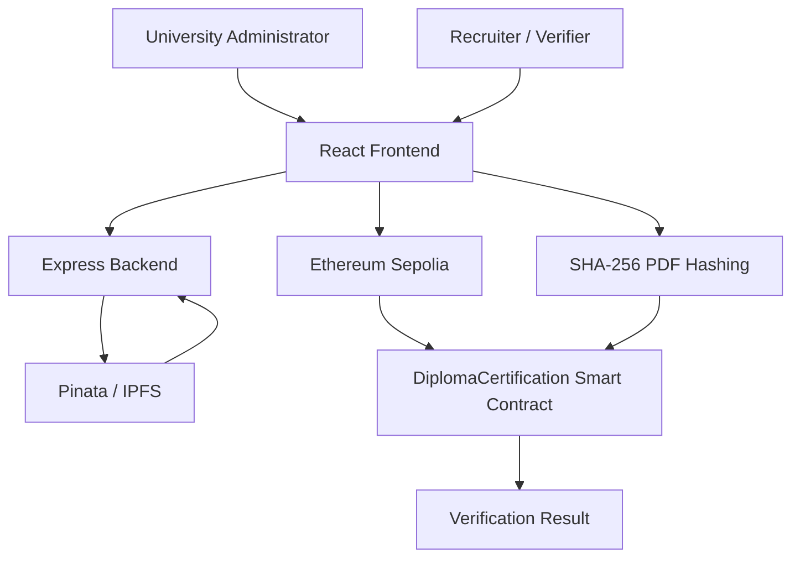

# Blockchain-Based Academic Diploma Certification & Verification

A decentralized academic diploma certification and verification platform built with **Solidity, Ethereum, IPFS, React, and Node.js**.

The system allows a university administrator to issue and revoke digital diplomas, while recruiters and other third parties can independently verify diploma authenticity by uploading the original PDF.

## 1. Project Overview

Traditional diploma verification often requires contacting the issuing university, which can be slow and difficult to automate.

This project provides a blockchain-based solution:

- **Integrity:** SHA-256 generates a unique fingerprint of each diploma PDF.
- **Decentralization:** Diploma records are registered on the Ethereum Sepolia blockchain.
- **Decentralized storage:** Diploma PDFs are uploaded to IPFS through Pinata.
- **Transparency:** Verification results can be checked without connecting a wallet.
- **Access control:** Only the university administrator (smart contract owner) can issue or revoke diplomas.

## 2. System Architecture



### Diploma issuance

1. The administrator connects their MetaMask wallet.
2. The administrator enters student information and selects a PDF.
3. The frontend calculates the PDF's SHA-256 hash.
4. The backend uploads the PDF to IPFS through Pinata.
5. The smart contract records the hash, IPFS CID, student information, and issue date.
6. The transaction is confirmed on Ethereum Sepolia.

### Diploma verification

1. A recruiter uploads a diploma PDF.
2. The frontend calculates its SHA-256 hash.
3. The frontend queries the smart contract.
4. The application displays one of the following results:
   - **Authentic:** The diploma exists and is valid.
   - **Revoked:** The diploma exists but has been revoked.
   - **Not registered:** No matching diploma exists on the blockchain.

### Diploma revocation

1. The administrator connects their wallet.
2. The administrator uploads the diploma PDF.
3. The frontend calculates its hash and retrieves the corresponding record.
4. The administrator confirms the revocation transaction.
5. The smart contract changes the diploma's validity status to `false`.

## 3. Technologies Used

| Component | Technology |
|---|---|
| Frontend | React 19, Vite |
| Styling | Tailwind CSS 4 |
| Blockchain | Ethereum Sepolia |
| Smart contracts | Solidity 0.8.28 |
| Development framework | Hardhat 2 |
| Wallet | MetaMask |
| Blockchain interaction | ethers.js 6 |
| Backend | Node.js, Express 5 |
| File uploads | Multer |
| Decentralized storage | IPFS, Pinata |
| PDF integrity | SHA-256 |
| Smart contract security | OpenZeppelin Ownable |

## 4. Project Structure

```text
diploma-blockchain/
│
├── contracts/
│   └── DiplomaCertification.sol
│
├── scripts/
│   ├── deploy.js
│   ├── interact.js
│   ├── interact-sepolia.js
│   └── register-diploma.js
│
├── test/
│   └── DiplomaCertification.js
│
├── frontend/
│   ├── src/
│   │   ├── components/
│   │   ├── context/
│   │   ├── contract/
│   │   ├── pages/
│   │   ├── App.jsx
│   │   ├── index.css
│   │   └── main.jsx
│   └── package.json
│
├── backend/
│   ├── server.js
│   └── package.json
│
├── hardhat.config.js
├── package.json
├── .env.example
└── README.md
```

## 5. Smart Contract

The `DiplomaCertification.sol` smart contract manages diploma registration, verification, and revocation.

### Main data structure

Each diploma contains:

- `hashPdf`: SHA-256 fingerprint of the original PDF.
- `cid`: IPFS content identifier.
- `nomEtudiant`: Student name.
- `filiere`: Academic program.
- `annee`: Graduation year.
- `dateEmission`: Blockchain issuance timestamp.
- `valide`: Current validity status.

### Main functions

| Function | Description | Access |
|---|---|---|
| `emettreDiplome()` | Registers a new diploma | Owner only |
| `verifierDiplome()` | Retrieves diploma information and existence | Public |
| `revoquerDiplome()` | Revokes an existing diploma | Owner only |

The contract prevents duplicate registration and uses OpenZeppelin's `Ownable` mechanism to restrict administrative operations.

## 6. Deployed Smart Contract

<badge>Ethereum Sepolia Testnet</badge>

| Detail | Value |
|---|---|
| Network | Ethereum Sepolia |
| Chain ID | `11155111` |
| Solidity version | `0.8.28` |
| Contract address | `0x4b3dEc9A800A5a633d94A509d3860996A4706B7f` |

**Blockchain explorer:**

[View DiplomaCertification on Sepolia Etherscan](https://sepolia.etherscan.io/address/0x4b3dEc9A800A5a633d94A509d3860996A4706B7f)

## 7. Installation and Configuration

### Prerequisites

Install the following tools:

- Node.js and npm
- Git
- MetaMask browser extension
- An Ethereum Sepolia account with test ETH
- A Pinata account
- An Ethereum Sepolia RPC endpoint

### Clone the repository

```bash
git clone https://github.com/VerVex-io/diploma-blockchain.git
cd diploma-blockchain
```

### Install root dependencies

```bash
npm install
```

### Install frontend dependencies

```bash
cd frontend
npm install
cd ..
```

### Install backend dependencies

```bash
cd backend
npm install
cd ..
```

## 8. Environment Variables

Create the following environment files. Never commit actual `.env` files or private keys.

### Root `.env`

```env
SEPOLIA_RPC_URL=YOUR_SEPOLIA_RPC_URL
PRIVATE_KEY=YOUR_WALLET_PRIVATE_KEY
```

The private key must belong to the administrator/deployer wallet. Never expose it in frontend code or share it publicly.

### Backend `.env`

```env
PORT=5000
FRONTEND_URL=http://localhost:5173
PINATA_JWT=YOUR_PINATA_JWT
PINATA_GATEWAY=YOUR_GATEWAY_DOMAIN
```

### Frontend `.env`

```env
VITE_API_URL=http://localhost:5000
VITE_CONTRACT_ADDRESS=0x4b3dEc9A800A5a633d94A509d3860996A4706B7f
VITE_DEPLOYMENT_BLOCK=12140518
```

Only public configuration belongs in the frontend environment file. Never put a private key or Pinata JWT in a `VITE_` variable.

## 9. Running the Application

Open three terminal windows from the project directory.

### Terminal 1: Start the backend

```bash
cd backend
npm run dev
```

Backend API:

`http://localhost:5000`

Health check:

`http://localhost:5000/api/health`

### Terminal 2: Start the frontend

```bash
cd frontend
npm run dev
```

Open:

`http://localhost:5173`

### Terminal 3: Smart contract development

Compile the contract:

```bash
npx hardhat compile
```

Run the automated tests:

```bash
npx hardhat test
```

Deploy to Sepolia (only when deploying a new contract):

```bash
npx hardhat run scripts/deploy.js --network sepolia
```

After deploying a new contract, update the frontend contract address and deployment block, and refresh the frontend ABI from the corresponding Hardhat artifact.

## 10. Application Features

### Dashboard

- Displays diploma statistics.
- Shows recent diploma registrations.
- Updates according to blockchain events.

### Issue Diploma

- Administrator-only access.
- Student information entry.
- PDF upload and SHA-256 calculation.
- IPFS storage.
- Blockchain registration.

### Verify Diploma

- Public access without MetaMask.
- PDF fingerprint calculation.
- Blockchain verification.
- Authentic, revoked, and not-registered results.

### All Diplomas

- Displays registered diplomas.
- Shows current validity status.
- Supports searching and refreshing.
- Provides blockchain transaction links.

### Revoke Diploma

- Administrator-only access.
- Retrieves a diploma using its PDF hash.
- Revokes the diploma through a blockchain transaction.

## 11. Security and Privacy Considerations

- Only the smart contract owner can issue or revoke diplomas.
- SHA-256 ensures that even a small modification to a PDF produces a different fingerprint.
- The backend restricts uploads to PDF files and limits file size to 10 MB.
- CORS is restricted to the configured frontend origin.
- Sensitive credentials are stored in environment variables.
- Diploma records and transaction history are publicly visible on the blockchain.
- Files uploaded to public IPFS storage may be accessible to anyone with their CID.

**Important:** This project is a demonstration using the Ethereum Sepolia test network. Use synthetic student information and non-sensitive sample diplomas. Do not upload real confidential academic documents to public IPFS.

## 12. Testing

The project includes automated smart contract tests covering core operations and access control.

The application has also been manually tested for:

- Successful diploma issuance.
- Verification of an original PDF.
- Rejection of a modified or unregistered PDF.
- Successful diploma revocation.
- Detection of revoked diplomas.
- Prevention of unauthorized administrative operations.
- MetaMask connection and network validation.
- Public verification without wallet connection.
- Dashboard and diploma registry updates.
- Backend health check.
- Invalid file rejection.
- Maximum upload size enforcement.

## 13. Future Improvements

Potential extensions include:

- University-specific roles and multiple authorized administrators.
- Support for multiple universities.
- QR-code-based diploma verification.
- Improved privacy using encrypted document storage.
- Production deployment with additional security controls.
- More advanced event indexing and pagination.

## 14. Author

**Project:** Blockchain-Based Academic Diploma Certification & Verification

**Repository:** [VerVex-io/diploma-blockchain](https://github.com/VerVex-io/diploma-blockchain)

**Network:** Ethereum Sepolia Testnet